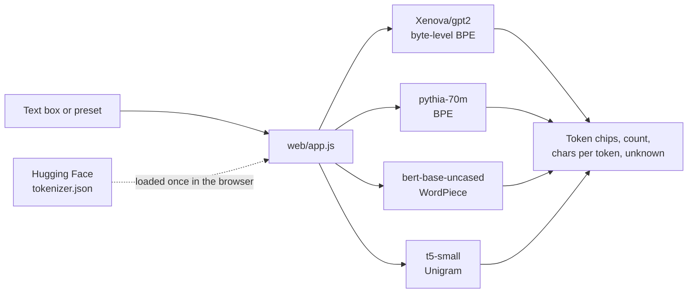

# ByteMe

Compare tokenization strategies: byte-level vs BPE vs WordPiece vs Unigram.

## What is this?

Tokenizers turn text into numbers. There are 4 main ways to do it. This project loads each one and compares them side by side on the same text.

## Tokenizers compared

| Strategy | Used by | How it works |
|----------|---------|-------------|
| Byte-level BPE | GPT-4, Llama | Starts from bytes, merges frequent pairs |
| BPE | Most modern LLMs | Starts from characters, merges frequent pairs |
| WordPiece | BERT | Similar to BPE but uses likelihood instead of frequency |
| Unigram | T5, XLNet | Starts big, removes tokens that hurt the least |

## Setup

```bash
pip install -r requirements.txt
```

## What we test

- Regular english and spanish text
- Python code
- Emojis and special characters
- URLs
- Rare/made-up words
- Japanese, Arabic, mixed scripts

## Key findings

- **Byte-level BPE** (GPT-2/4) is the most robust. Never produces UNK tokens. Handles any language or input.
- **WordPiece** (BERT) struggles with non-english and code. Small vocab means more splitting.
- **Unigram** (T5) is surprisingly good at multilingual thanks to SentencePiece.
- The industry converged on byte-level BPE for good reason: never bad at anything.

## Web version

`web/` is a static page: type text and see the four tokenizers side by side with token count, chars per token and unknown tokens. Tokenization runs in the browser with Transformers.js, no backend.

```bash
python3 -m http.server 8000 --directory web
```

## How the page works



Parity check: every preset tokenizes identically in the browser and in the Python notebook (8 presets x 4 tokenizers, 0 diffs on 2026-10-12).

## Run

Open `byteme.ipynb` in Jupyter or run on [Kaggle](https://kaggle.com).
